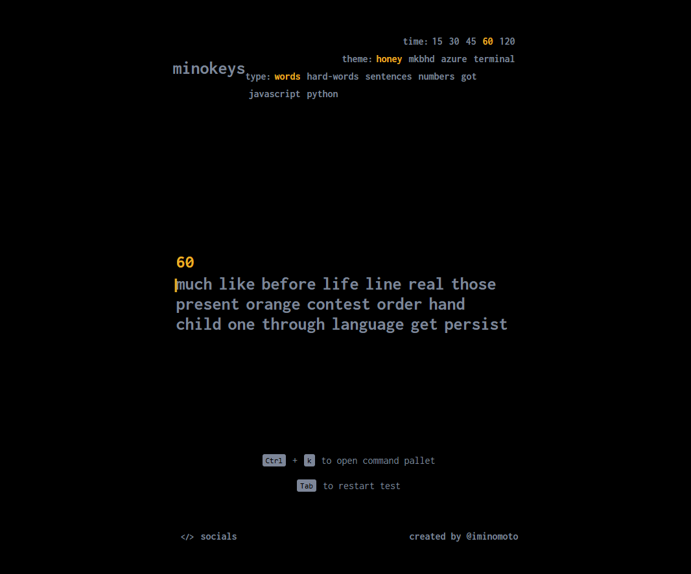
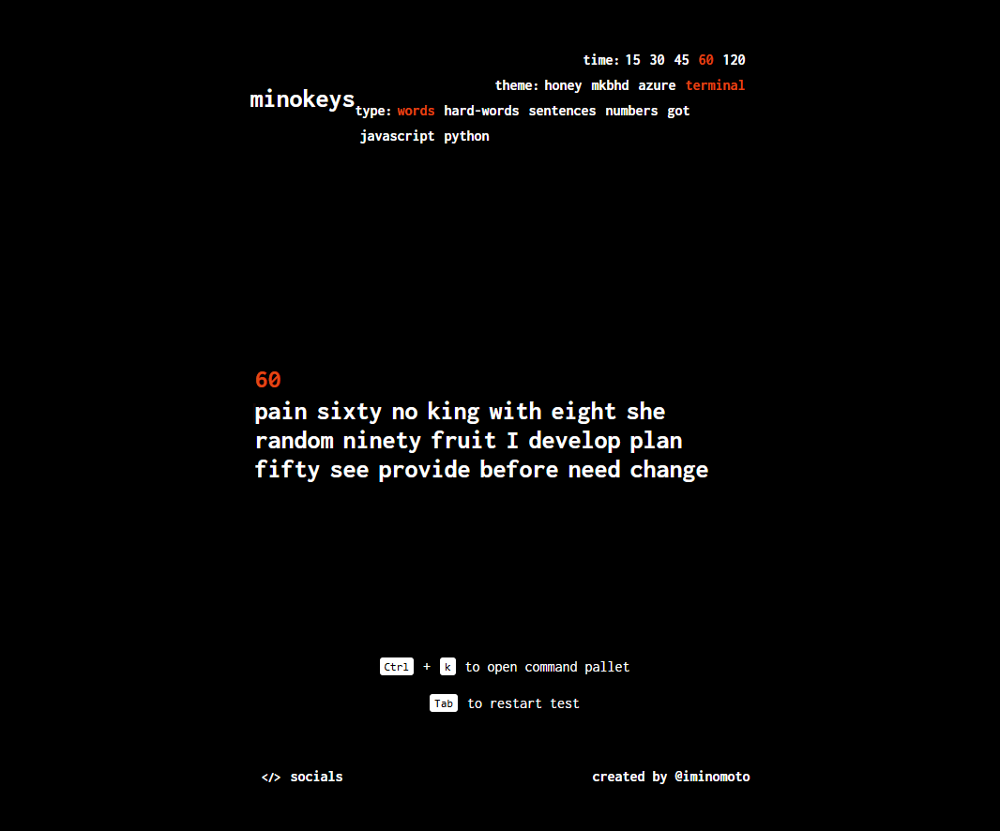

<div align="center">

# Minokeys

**⏱️ A minimal, no-frills typing test — pick a mode, sprint the clock, chase your WPM.**

No accounts. No charts. No bloat. Just you, a wall of words, and 60 seconds.

[](https://minokeys.vercel.app)
[](LICENSE)
[](https://react.dev)



</div>

---

## 🎯 What is this?

Minokeys is a **minimalistic, keyboard-first typing test**. It stays out of your way while you type — the header and footer fade out the moment the clock starts — then snaps back with your score.

Seven test modes, time sprints from 15 s to 2 min, instant themes with a slick radial switch animation, and a **command palette** for the truly keyboard-bound.

## ✨ Features

| | |
|---|---|
| 🏃 **7 test modes** | English words, hard words, sentences, number drills, Game of Thrones quotes, JavaScript & Python vocabulary |
| ⏱️ **Time sprints** | 15 / 30 / 45 / 60 / 120 s — the timer only starts on your **first keystroke** |
| 🎨 **Instant themes** | `honey`, `mkbhd`, `azure`, `terminal` — with a radial ripple animation that expands from the button you click |
| ⌨️ **Command palette** | <kbd>Ctrl</kbd>+<kbd>K</kbd> — change time, theme and mode without touching the mouse |
| 💡 **Letter-level feedback** | Correct characters light up, mistakes turn red, and overtyped extra letters appear inline as you spill past the word |
| 🌊 **Smooth caret** | A blinking caret that glides along the word and pauses blinking while you type |
| 🧘 **Distraction-free** | Header and footer fade to invisible while the test runs |
| 💾 **Remembered settings** | Theme, mode and duration persist in `localStorage` |
| 📊 **The score** | WPM (standard 5-chars-per-word formula), correct vs. incorrect words — and a one-click restart |

## 🧪 Test modes

| Mode | What you'll type | Bank |
|---|---|---|
| `words` | Common English words | 329 |
| `hard-words` | Tongue-twisters like *internationalization* | 65 |
| `sentences` | Everyday prose, one line at a time | 32 |
| `numbers` | Random digit strings for number-row drills | 299 |
| `got` | Game of Thrones quotes — *"The things I do for love."* | 12 |
| `javascript` | `Array`, `eval` and friends | 84 |
| `python` | `False`, `None`, `True`... | 105 |

## 🎨 Themes

| `honey` *(default)* | `terminal` |
|:---:|:---:|
|  |  |

Plus `mkbhd` and `azure` — and a dozen more layouts (vscode, ocean, forest, mocha...) already waiting in [`themes.scss`](src/stylesheets/themes.scss).

## ⌨️ Shortcuts

| Key | Action |
|---|---|
| <kbd>Tab</kbd> | Restart the test at any time |
| <kbd>Ctrl</kbd> + <kbd>K</kbd> | Toggle the command palette |
| <kbd>Space</kbd> | Commit the word and move on |
| <kbd>Backspace</kbd> | Fix a letter — or go back a whole word when empty |
| <kbd>Ctrl</kbd> + <kbd>Backspace</kbd> | Wipe the entire word |
| <kbd>↑</kbd> / <kbd>↓</kbd> / <kbd>Enter</kbd> / <kbd>Esc</kbd> | Navigate, select and close the palette |

## 🛠️ Under the hood

```
src/
├── App.tsx                  # Global key capture: every key becomes part of the test
├── components/
│   ├── Header.tsx           # Options bar + radial theme animation
│   ├── Test.tsx             # The word wall, caret and active-word refs
│   ├── CommandPallet.tsx    # Ctrl+K palette (fuzzy filter, arrow-key nav)
│   ├── Result.tsx           # WPM + word accuracy table
│   └── Footer.tsx           # Shortcut hints, hidden mid-test
├── helpers/                 # recordTest · resetTest · startTimer
├── store/                   # Redux: timer · word · preferences slices
├── stylesheets/             # themes as CSS custom properties
└── wordlists/               # one JSON array per mode, lazily imported
```

**How a test works:**

1. On load, the chosen wordlist is `import()`-ed lazily and shuffled
2. Every keystroke is captured globally and dispatched through `recordTest` — a single character appends to the word, <kbd>Space</kbd> commits it, <kbd>Backspace</kbd> rewinds
3. The active word auto-scrolls into view; each character is marked `right`/`wrong` the moment you type it
4. The timer starts on your first key and counts down every second
5. At zero: `wpm = (correctChars + spaces) × 60 / timeLimit / 5` — the classic 5-chars-per-word metric

## 🚀 Run it locally

```bash
git clone https://github.com/iminomoto/minokeys.git
cd minokeys
npm install
npm start        # dev server at localhost:3000
npm run build    # production build
```

## 🎨 Make it yours

**Add a theme** — drop a new class into `src/stylesheets/themes.scss`:

```scss
.my-theme {
    --bg-color: background-color;
    --font-color: font-color;
    --hl-color: highlight-color;   /* caret, mistakes, timer, hover */
    --fg-color: foreground-color;  /* correctly typed characters */
}
```

**Add a wordlist** — save `src/wordlists/<name>.json` as a single array of words or sentences.

Then register both in the `options` object in `src/components/Header.tsx` — the names must match the CSS class / JSON filename exactly. Open a PR and your theme could ship in the next release.

## 🙏 Credits

Minokeys is built on top of [**salmannotkhan/typing-test**](https://github.com/salmannotkhan/typing-test) — a React recreation of the wonderful [**monkeytype**](https://monkeytype.com). All credit for the original design and architecture goes there; this fork keeps the MIT license and carries the idea forward.

## 📄 License

[MIT](LICENSE) — type, fork, restyle.

---

<div align="center">

*⭐ If it improved your WPM by even one point, a star is cheaper than a mechanical keyboard.*

</div>
